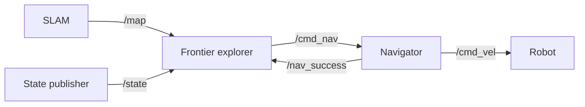

# Understanding the frontier exploration node

This explains the **simplified node currently on `section7`**, from basic ideas
to the system and then its methods. [Read the source alongside this guide.](https://github.com/akjain47/aa274/blob/section7/autonomy_repo/scripts/frontier_exploration.py)

The homework functions `window_counts()` and `explore()` are outside this
walkthrough. Treat `explore(map)` as a helper that returns candidate destinations
as an array of `(x, y)` positions. Stop-sign behavior is a later lab extension
and is not part of this node.

## 1. Start with the basic problem

A robot exploring an unfamiliar room needs to answer three different questions:

1. **Where am I, and what have I seen?** Pose estimation and SLAM provide this.
2. **Where should I go next?** This exploration node chooses a destination.
3. **How do I get there?** The navigator plans a path and commands motion.

Keeping these jobs separate lets the explorer send a destination without
implementing motor control or path planning itself.

A **frontier** is a promising location near the boundary between observed space
and unknown space. Moving toward one lets the sensors see more of the room.
As the map changes, the useful destinations change too.

The explorer therefore repeats a feedback loop:

> Read the latest information → choose a goal → wait for the outcome → choose again.

### The ROS ideas used to implement that loop

| Idea | Meaning here |
| --- | --- |
| Node | One running program with its own stored information and callbacks |
| Message | A structured piece of data, such as a pose or a Boolean result |
| Topic | A named channel on which programs exchange messages |
| Publisher | Sends messages onto a topic |
| Subscription | Receives messages from a topic |
| Callback | A function ROS calls when a message arrives |
| Timer | Asks ROS to call a function periodically |

`self` means this particular node object. Assigning `self.state = msg` keeps the
message available after the callback finishes, so another method can use it.

## 2. How the node fits into the system



SLAM updates the map from sensor observations. The state publisher obtains the
robot pose from the transform tree. The explorer consumes both and sends a goal.
The navigator moves toward that goal and reports an outcome.

| Topic | Explorer's role | Data and meaning |
| --- | --- | --- |
| `/state` | Subscribe | `TurtleBotState`: current `x`, `y`, `theta` |
| `/map` | Subscribe | `OccupancyGrid`: cell values and map geometry |
| `/cmd_nav` | Publish | `TurtleBotState`: desired `x`, `y`, `theta` |
| `/nav_success` | Subscribe | `Bool`: position reached, or planning/replanning failed |

The same pose message type represents both a current pose and a desired pose.
The topic tells the receiver which meaning applies. Positions use the map frame
and meters; heading uses radians.

The explorer never publishes `/cmd_vel`. The navigator owns motion control.
In the provided navigator, a normal success message occurs when the position
threshold is met and final heading alignment begins; it need not mean that final
rotation has finished.

### The small amount of memory that connects the methods

| Variable | Meaning | Initial value |
| --- | --- | --- |
| `state` | Latest robot pose | `None` |
| `occupancy` | Latest map in the course grid wrapper | `None` |
| `active_goal` | Destination whose result we are waiting for | `None` |
| `failed_goals` | Failed positions paired with retry-expiry times | `[]` |

`None` means “we do not have this yet” or “there is no active goal.”

`active_goal` provides the key rule: **send one goal, then wait for feedback**.
While waiting, map and pose callbacks continue replacing their stored values.
The next goal therefore uses recent information.

## 3. The methods, built up from their smaller responsibilities

### `__init__()` — Give the node its memory and connections

The constructor runs once when `FrontierExploration()` creates the object.

It first calls `super().__init__("frontier_exploration")`. `super()` delegates to
the ROS `Node` class, which provides publishers, subscriptions, timers, logging,
and the node clock.

It then declares these settings:

| Parameter | Default | Purpose |
| --- | --- | --- |
| `frontier_window_size` | `11` cells | Passed to the homework frontier detector |
| `min_unknown` | `0.25` | Passed to the homework frontier detector |
| `min_free` | `0.35` | Passed to the homework frontier detector |
| `occupied_thresh` | `50` | Cell values at or above this are occupied |
| `occupancy_window_size` | `9` cells | Neighborhood for the grid's occupancy check |
| `min_goal_distance` | `0.4` m | Skip destinations very close to the robot |
| `failed_goal_radius` | `0.4` m | Exclude nearby alternatives to a failed goal |
| `failed_goal_cooldown` | `60.0` s | Time before a failed region may be tried again |

Declaring parameters makes the settings configurable through ROS. The two window
sizes must be positive odd integers so each neighborhood has a center cell.

Finally, the constructor initializes the memory shown above, creates the topic
connections, and registers a timer:

```python
self.timer = self.create_timer(1.0, self.select_goal)
```

This requests a goal-selection check every second of the node's clock. A check
does not necessarily publish a goal. The `10` in the publisher/subscription
calls is queue depth, not a 10 Hz rate.

### `state_callback(msg)` — Remember where the robot is

**Called by:** a message arriving on `/state`.

```python
self.state = msg
```

That is the whole method. If the robot moves from `(1, 2)` to `(1.2, 2)`, the
new message replaces the previous one. We only need the latest pose for choosing
the next destination, so this node does not store the pose history.

### `map_callback(msg)` — Turn the ROS map into a useful grid object

**Called by:** a message arriving on `/map`.

A map message contains both the cell data and the information needed to interpret
it: resolution, width, height, and origin. For example, resolution `0.05` means
one cell spans 5 cm; the origin places the grid in the map coordinate frame.

The method checks that dimensions and resolution are valid and the data length
matches `width × height`. Invalid messages are ignored. It also rejects rotated
map origins because the course grid wrapper assumes an axis-aligned grid.

It then constructs `StochOccupancyGrid2D` and stores it in `self.occupancy`.
The wrapper reshapes the cell data and provides coordinate-conversion and
occupancy-checking methods. Cell values remain in ROS format:

- `-1`: unknown.
- `0` through `49`: below this node's occupied-cell threshold.
- `50` through `100`: at or above the occupied-cell threshold.

There are two coordinate systems to keep straight:

| Representation | Example | Used for |
| --- | --- | --- |
| Map position `(x, y)` | `(1.0, 2.0)` meters | Robot poses and goals |
| Grid index `(kx, ky)` | Column and row numbers | Looking up a cell value |

`state2grid()` converts a position to indices. The array is indexed as
`probs[ky, kx]`: row first, column second.

This callback prepares the map; it does not choose a destination.

### `now_seconds()` — Get time from the same clock as ROS

**Called by:** goal selection and failure handling.

```python
return self.get_clock().now().nanoseconds * 1e-9
```

The clock reports nanoseconds. Multiplying by `1e-9` converts them to seconds.
For example, `12_500_000_000` nanoseconds becomes `12.5` seconds.

With `use_sim_time=true`, this follows `/clock`, so cooldown time follows the
simulation and pauses when simulation time pauses. On hardware it follows the
node's normal clock.

### `send_goal(goal)` — Package a destination and remember the pending request

**Called by:** `select_goal()` after finding an acceptable candidate.

Its input is a two-element array, `[goal_x, goal_y]`. First it computes the vector
from the current position to the goal:

```python
delta = goal - current
theta = np.arctan2(delta[1], delta[0])
```

`atan2` turns that vector into a heading. From `(0, 0)` toward `(1, 1)`, the
requested heading is about `0.785` radians, or 45 degrees.

The method puts `x`, `y`, and `theta` into a `TurtleBotState`, records a copy in
`active_goal`, and publishes the message on `/cmd_nav`. Remembering the goal
before publishing means the node is ready to associate incoming feedback with
its pending request. `.copy()` gives the stored position its own array.

Publishing starts an asynchronous request. This method returns immediately;
later `/nav_success` feedback tells the explorer what happened.

### `result_callback(msg)` — Finish the pending request

**Called by:** a message arriving on `/nav_success`.

If there is no `active_goal`, the method ignores the message. Otherwise:

- `True`: log that the frontier was reached.
- `False`: save the failed position with an expiry of `now + 60 seconds`.

Both outcomes then set `active_goal = None`, allowing a later timer check to
choose another goal. This callback does not publish the next goal itself.

Why remember a failed **region**? Adjacent frontier cells may all represent the
same blocked destination. Skipping a 0.4 m neighborhood prevents immediately
trying a nearly identical goal a few centimeters away.

The failure record is temporary. As the robot maps more of the room, a route
to that region may become available.

### `select_goal()` — Put the smaller pieces together

**Called by:** the one-second timer. This is the main decision method.

**Step 1: Check readiness.** Return immediately if the pose or map is missing,
or a goal is already active. Also wait for a `/cmd_nav` subscriber and a
`/nav_success` publisher. These connection checks help avoid sending requests
before the navigator connects.

Here, `return` just ends this check. ROS keeps listening and the timer will run
again. It does not end the program.

**Step 2: Remove expired failures.** Keep only records with `expiry > now`.
Once a cooldown expires, that location becomes eligible again.

**Step 3: Ask the homework helper for candidates.** Call `explore()` with the
latest map and configured detector settings. The result has one row per
candidate and two columns: `x` and `y`.

**Step 4: Order candidates by distance.**

```python
distances = np.linalg.norm(frontiers - current, axis=1)
for index in np.argsort(distances, kind="stable"):
    goal = frontiers[index]
```

Subtracting `current` computes the displacement to every candidate. The norm
computes one straight-line distance per row. `argsort` returns their indices
from nearest to farthest; `stable` preserves the input order for equal distances.

**Step 5: Walk through that order and reject unsuitable goals.**

| Check | Why reject the candidate? |
| --- | --- |
| Distance below 0.4 m | Avoid tiny moves and very short planner paths |
| Within 0.4 m of a recent failure | Avoid repeating essentially the same failed request |
| Center cell unknown or occupied | Require an observed free destination |
| `occupancy.is_free(goal)` is false | Require the library's neighborhood occupancy check to pass |

Each rejection uses `continue`, which means “try the next candidate.” The
homework helper can return unknown candidate centers, so the explicit known-cell
check matters. The neighborhood check is an additional check; an acceptable
center cell alone is insufficient.

**Step 6: Send the first acceptable goal and return.** This prevents sending
multiple commands in one timer check. If all candidates are rejected, simply
wait and try again on the next tick using the latest information.

The simplified node does **not** compute connected regions or run A*. A valid
destination cell can still be unreachable. The navigator discovers that and
reports failure, which feeds back into `result_callback()`.

### `main()` — Start ROS and keep the callbacks running

`main()` is the program entry function, rather than a method of the class.

```python
rclpy.init(args=args)
node = FrontierExploration()
rclpy.spin(node)
```

Initialization starts the ROS context. Creating the object runs `__init__()`.
`spin()` then processes incoming messages and timer events. The node spends its
life responding to those events, rather than executing its own busy loop.

On Ctrl+C, the surrounding `try`/`finally` releases the node's ROS resources
and shuts down the context if it is still running.

## 4. Follow one complete example

Assume the robot is at `(0, 0)` and the helper returns free candidates:

| Candidate | Position | Distance |
| --- | --- | --- |
| A | `(0.5, 0)` | 0.5 m |
| B | `(1.0, 0)` | 1.0 m |
| C | `(0, 2.0)` | 2.0 m |

1. At startup, `state` and `occupancy` are `None`; timer checks return.
2. Pose and map messages arrive; their callbacks save the data.
3. A timer check chooses A, stores it as `active_goal`, and publishes it.
4. Further timer checks see an active goal and return; map and pose still update.
5. At time 10 s, the navigator reports failure. A is recorded with expiry 70 s,
   and `active_goal` becomes `None`.
6. Assuming the same pose and candidates, the next check skips A. B is 0.5 m
   from A, outside its 0.4 m exclusion radius, so B can be sent.
7. When B succeeds, its pending request is cleared. The next selection uses the
   robot's updated position and the updated map.
8. On a selection check at or after 70 s, A's failure record expires. A may be
   retried if it remains a suitable candidate.

## 5. What the current design assumes

- Goals are ranked by straight-line distance, not route length or expected new
  map coverage. The navigator performs whole-path planning and collision checks.
- `/nav_success` has no goal ID. The feedback scheme assumes this explorer is
  the source of navigation goals during exploration.
- An active goal has no explorer-side timeout; the node waits for navigation
  feedback. A missing result leaves `active_goal` set.
- No usable frontiers means “wait and check again.” There is no completion flag
  or calculation of the fraction of the environment that has been mapped.

The launch file starts the navigator, state publisher, RViz, and this explorer
with a shared `use_sim_time` setting. Its three-second explorer delay helps
startup ordering; the readiness checks still decide when a goal can be sent.
